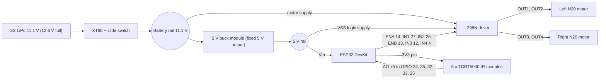

# Task 6: Electronics and Hardware

Items marked TODO-BOM depend on the final BOM and are to be confirmed later.

## 1. Wiring diagram

### Pin connections

| From | To | Note |
|------|----|------|
| Sensor S1 to S5 (AO) | GPIO 34, 35, 32, 33, 25 | Analog, 0 to 3.3 V |
| Sensor VCC | ESP32 3V3 pin | Keeps AO at or below 3.3 V |
| ENA / IN1 / IN2 | GPIO 14 / 27 / 26 | Left motor PWM and direction |
| ENB / IN3 / IN4 | GPIO 13 / 12 / 4 | Right motor. IN4 moved from GPIO 11 (SPI flash pin, not usable) |
| L298N OUT1, OUT2 | Left motor terminals | |
| L298N OUT3, OUT4 | Right motor terminals | |
| Buck converter IN | Battery rail after the switch | Fixed 5 V output; measure it with a multimeter before connecting the ESP32 |
| Buck converter OUT | ESP32 Vin and L298N logic 5 V terminal | |
| L298N motor supply terminal | Battery rail after the switch | |

Notes:
- GPIO 12 (IN3) is a strapping pin on the ESP32: its level at boot selects the flash voltage, so it must not be pulled high at reset. Confirm in the ESP32 datasheet; if boot problems appear, move IN3 to another free pin and change the sketch.
- The chosen motors have no encoders, so there are no encoder wires. An encoder extension would need different motors.
- Do not connect USB and the battery rail to the ESP32 at the same time without a diode; use one power source when programming.

### Supply voltages

| Rail | Voltage | Source | Feeds |
|------|---------|--------|-------|
| Battery | 11.1 V nominal, 12.6 V full, about 9.9 V at the low cut-off | 3S LiPo | L298N motor supply, buck input |
| 5 V | 5.0 V | Buck converter (fixed 5 V, checked with a multimeter) | ESP32 Vin, L298N logic supply (VSS) |
| 3.3 V | 3.3 V | ESP32 on-board regulator | IR sensor modules, signal levels |

The L298N logic supply VSS must be 4.5 to 7 V (ST datasheet), so it is fed from the 5 V buck rail and not from the 3.3 V pin. The L298N module's on-board 5 V regulator jumper is removed so the module does not feed or fight the buck converter (TODO-BOM: confirm the jumper and regulator limits on the chosen module).

### Common ground topology

All grounds are joined: battery negative, buck converter GND, L298N GND, ESP32 GND and sensor GND. Without a shared reference, the 3.3 V logic signals from the ESP32 have no defined meaning at the L298N inputs and the sensor readings float.
To keep motor current away from the logic ground, the heavy return path (battery negative to the L298N GND terminal) is kept short and thick, and the ESP32 and sensor grounds are taken from that same point with their own thin wires (a star-style connection), instead of daisy-chaining the sensors through the motor return path.
A bulk capacitor (about 470 to 1000 uF, rated at least 16 V) is placed across the L298N motor supply terminals to supply motor start-up current (TODO-BOM: add the capacitor to the BOM).

### Role of the motor driver

The ESP32 GPIO pins can supply only a few milliamps and cannot drive a motor directly. The L298N is an H-bridge: it takes low-power logic signals and switches the battery voltage to the motor.
- IN1/IN2 (and IN3/IN4) choose the direction by deciding which side of the motor is connected to the battery and which to ground.
- ENA/ENB take the PWM signal, which sets the average voltage and so the speed.
- The driver isolates the 11.1 V motor power from the 3.3 V logic and allows reversing, which the lost-line recovery (pivot) uses.

## 2. Troubleshooting analysis: the controller resets when the motors engage

**Symptom:** the robot runs normally while stationary, but when the motors start (or the robot accelerates or stalls) the ESP32 reboots and the serial monitor restarts.

**Probable root causes (most to least likely):**
1. **Supply sag (brownout).** Motor start-up and stall draw a large current (about 1.1 A per motor, assumed and to be measured). That pulls the battery voltage down and, through the buck converter, can pull the 5 V rail and the 3.3 V regulator input below what the ESP32 needs, so its brownout detector resets it.
2. **Shared ground impedance.** Motor return current flowing through the same thin wire or breadboard rail as the ESP32 ground creates a voltage drop, so the logic ground moves relative to the rest and the ESP32 sees a glitch.
3. **Electrical noise from the brushed motors and PWM switching** coupling into the power rail and reset (EN) line.
4. **A weak supply path:** an under-rated or poorly set buck converter, a loose XT60 or connector, or a long thin battery lead that drops voltage under load.

**First diagnostic check:** read the reset reason. Open the serial monitor at 115200 baud: a brownout reset prints a brownout message at boot, which separates a power problem from a software crash. At the same time measure the 5 V rail at the ESP32 Vin pin with a multimeter (min/peak hold if available, or an oscilloscope) while the motors start. If the rail dips noticeably at the moment of reset, the cause is supply sag or ground bounce, not code.

**Fix steps:**
1. Add the bulk capacitor across the motor supply and a small ceramic capacitor (about 100 nF) across each motor's terminals.
2. Shorten and thicken the battery and motor ground path; connect the logic grounds at one point (star connection).
3. Add a soft start in firmware: ramp the PWM up over some tens of milliseconds instead of jumping to full speed.
4. Check the buck converter output measures 5.0 V, is rated for the load, and the connectors are tight.

**How to confirm the fix:**
- The 5 V rail minimum during motor start-up stays within a small margin of 5 V (target: dip well under 0.3 V; this threshold is a starting guess to be set from measurements).
- No reset message appears over repeated start-ups (for example 20 starts) and over a 10-minute run, including a deliberate brief stall.
- Compare the measured rail trace before and after the changes to show the improvement.

## 3. Assumptions and limitations

- The diagram is a design, not a tested build; the strapping-pin note and the module's regulator limits must be checked on the real hardware.
- The capacitor values are typical starting values, to be tuned from measurement.
- The thresholds in the confirmation step are initial guesses.
## 4. Addendum: end-zone LED

GPIO 23 goes through a 220 ohm resistor to the anode of a red LED; the cathode goes to ground. The LED lights when the end box is detected (competition rule). The diagram above does not show it yet.
